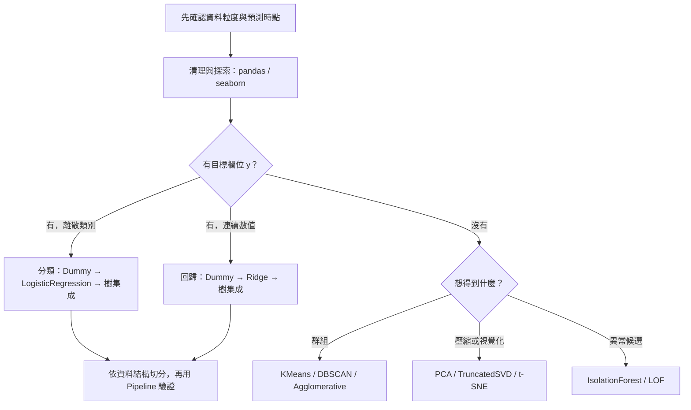

# ML100Days｜依情境查找的資料與模型工具書

這個 repo 保留原本的 `homework/` 作業筆記，並新增以 **問題 → 判斷 → 工具 → 可執行範例** 編排的現代工具書。原作業是學習歷程；遇到 API 差異時，請以 `guide/` 和 `examples/` 為準。深度學習的現代教學統一使用 **PyTorch**。更新檢視日期：2026-10-14。

## 30 秒找到入口

| 你正在做什麼 | 先看 | 常用工具 | 可執行範例 |
|---|---|---|---|
| 讀入、清理、合併、探索資料 | [資料分析與整理](guide/data.md) | pandas、NumPy、seaborn、matplotlib | [資料整理](examples/data_workflow.py) |
| 有標籤，預測類別或數值 | [模型選擇與評估](guide/ml.md) | scikit-learn 的 Pipeline、線性模型、樹模型 | [分類](examples/tabular_classification.py)／[回歸](examples/tabular_regression.py) |
| 沒有標籤，想分群或降維 | [非監督學習](guide/unsupervised.md) | KMeans、DBSCAN、PCA、t-SNE | [分群與降維](examples/unsupervised.py) |
| 影像／大量非結構化資料，需要神經網路 | [PyTorch 教學](guide/pytorch.md) | torch、`torch.nn`、`DataLoader`、torchvision | [PyTorch 訓練](examples/torch_training.py) |
| 舊 notebook 執行失敗 | [舊語法遷移](guide/migration.md) | 新 API 對照、資料洩漏檢查 | [舊作業索引](guide/legacy-index.md) |

深度學習可直接從 [7 本 PyTorch 練習 notebook](modern/torch/README.md) 開始；各本預設使用可離線執行的合成資料。

> **先問三件事**：一列代表什麼（資料粒度）？預測時哪些欄位真的可取得？資料是否有時間或同一個人的重複紀錄？答案決定切分方法，比先挑模型更重要。

## 快速決策

1. **沒有目標欄位**：描述、視覺化 → [資料整理](guide/data.md)；分群／降維 → [非監督學習](guide/unsupervised.md)。
2. **有目標欄位**：離散類別 → 分類；連續數值 → 回歸。先用簡單基準，再比較較複雜模型 → [模型選擇](guide/ml.md)。
3. **影像、文字、音訊等非結構化輸入**：先查是否可用預訓練模型；需要自訂訓練時用 [PyTorch](guide/pytorch.md)。表格資料通常先試 scikit-learn，不要直接跳神經網路。
4. **評估方式**：時間資料按時間切；同一實體重複出現用 group 切；分類且樣本獨立可分層。所有填補、縮放、編碼與特徵選擇只在訓練資料上擬合。



## 流程圖

Diagram Design 製作的單檔 HTML 流程圖可下載後用瀏覽器開啟；每個分支都標出可用工具。文件中的表格提供搜尋與複製語法的入口。

- [資料分析與清理：問題 → 工具](guide/diagrams/data-flow.html)
- [有標籤資料：分類／回歸模型選擇](guide/diagrams/supervised-flow.html)
- [無標籤資料：分群／降維選擇](guide/diagrams/unsupervised-flow.html)
- [PyTorch：架構、訓練與驗證](guide/diagrams/torch-flow.html)

## 環境與執行

建議 Python 3.11 以上；使用新的虛擬環境。一般分析與 ML：

```bash
python -m venv .venv
python -m pip install -r requirements-modern.txt
python examples/data_workflow.py
python examples/tabular_classification.py
python examples/tabular_regression.py
python examples/unsupervised.py
```

PyTorch 的安裝指令依作業系統和 CUDA 版本而異，請先用 [官方安裝選擇器](https://pytorch.org/get-started/locally/) 安裝 `torch`；影像章節再安裝相容的 `torchvision`。CPU 也可執行 [訓練範例](examples/torch_training.py)。要開啟 notebook，可在環境中另裝 `jupyterlab`，或用支援 Jupyter 的編輯器。

`homework/` 含舊 Kaggle 資料路徑、網路資源及當年的套件版本，**不保證可直接重跑**；[索引](guide/legacy-index.md) 說明各作業在新工具書中的對應位置。這次保留原檔，避免覆蓋個人筆記與原始實驗結果。

[更新與驗證紀錄](guide/verification.md) 記載實際執行環境、檢查範圍與原作業的限制。

## 參考文件

[pandas User Guide](https://pandas.pydata.org/docs/user_guide/) · [scikit-learn User Guide](https://scikit-learn.org/stable/user_guide.html) · [PyTorch Tutorials](https://docs.pytorch.org/tutorials/) · [torchvision models](https://docs.pytorch.org/vision/stable/models.html)
